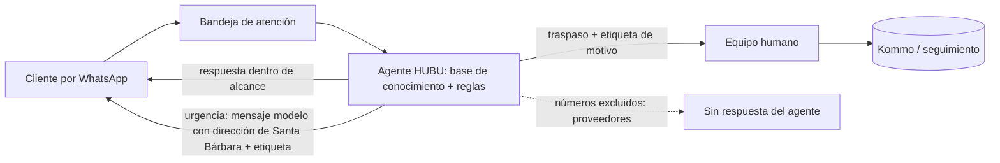

# Agente de IA de la Tienda de Mascotas (Pet Center) — en producción desde el 5/11/2026

**Estado: en producción, en observación diaria.** Primer corte de funcionamiento: 9/11/2026 (periodo 5–9 nov). Este documento sustituye al estado "en construcción" que figuraba para el agente de WhatsApp en `hubu-estado-vigente.md`.

## Qué es y qué no es

Agente conversacional sobre el WhatsApp de la Tienda de Mascotas de Dover, construido sobre la plataforma HUBU (proveedor externo) y conectado a la bandeja de atención de la línea. Atiende en las franjas donde no hay personal humano: lunes a sábado de 9 p. m. a 8 a. m. y domingos y festivos las 24 horas (el chat humano atiende lunes a sábado de 8 a. m. a 9 p. m.). La clínica y las urgencias sí atienden 24/7 en Sede Santa Bárbara.

**Alcance deliberadamente limitado:** no confirma existencias, precios ni dosis; no agenda citas médicas; ante cualquier duda, pasa al equipo con una etiqueta de motivo. La conexión al canal de producción requiere autorización explícita del responsable del proyecto.

## Arquitectura (a nivel de componentes)

- **Conocimiento:** documento estructurado por apartados con reglas de oro, flujos por tipo de solicitud (magistral, producto de venta directa, domicilio), regla de urgencias (apartado 7) y glosario. Se alimentó con dos datasets anonimizados (ver `dataset-whatsapp-pet-center.md`).
- **Reglas de oro vigentes (9/11):** (a) consulta, cita o precio de servicio médico → remitir al teléfono del call center, sin ofrecer pasar al equipo ni dar precios; (b) nunca mencionar otra clínica, dirección distinta a la de Santa Bárbara, precio de consulta ni horario que no esté en el documento.
- **Etiquetas de traspaso:** `urgencia`, `medicamento`, `pedido`, `dato_por_confirmar`, entre otras, para poder medir por motivo.

## Línea de tiempo

| Fecha | Hito |
|---|---|
| 2/10 | Dataset ampliado con 35 conversaciones reales anonimizadas de la línea |
| 19/10 | Plan: piloto en una semana, en el horario con menos atención humana |
| 4/11 | Aprobación del piloto, condicionada a que el proveedor termine los ajustes de entrenamiento |
| 5/11 | Lanzamiento en producción |
| 6/11 | Regla de urgencias: remitir de inmediato a la sede con atención 24 h (se descarta el PBX, que no funcionaba) |
| 9/11 | Primer informe de funcionamiento y ronda de ajustes |

## Resultados del primer corte (5 al 9 de noviembre, mañana)

Base: panel del proveedor y lectura completa de 37 conversaciones. Son datos leídos a mano en un periodo corto: sirven de línea base, no de tendencia.

| Indicador | Valor |
|---|---|
| Conversaciones nuevas en el periodo | 37 |
| Con respuesta del agente | 23 (62 %) |
| Pasadas a una persona | 15 (65 % de las atendidas por el agente) |
| Urgencias reales atendidas con la regla nueva | 1, correcta (domingo, mensaje modelo con dirección y etiqueta) |
| Datos inventados detectados | 1 |
| Urgencias no escaladas bien (según el panel del proveedor) | 1 en 48 h |

**Lo que funciona:** respeta las reglas de oro (no confirma existencias ni precios y pasa con etiqueta); respuestas cortas con una sola pregunta; "quiero un asesor" se pasa de inmediato; reconoce el contenido de una foto y lo usa para pasar el caso con contexto.

## Fallas encontradas y qué se hizo

| Hallazgo | Riesgo | Acción |
|---|---|---|
| El agente envió a un cliente datos de una clínica inexistente (dirección, precio de consulta y horario) | Alto | Regla de oro explícita; se pidió al proveedor la causa raíz (posible texto de ejemplo filtrado a producción) |
| Una urgencia indirecta ("¿a qué número me comunico para una urgencia?") se respondió con un teléfono | Alto | Regla de urgencias consolidada en un solo apartado; cubre preguntas indirectas y siempre responde con la dirección, nunca un teléfono |
| Reglas de urgencias duplicadas y contradictorias entre secciones | Alto | Se retiraron las dos reglas duplicadas y se corrigió la sección 2 |
| Pregunta repetida ("¿magistral o venta directa?", "¿domicilio o recoges?") aunque el cliente ya respondió | Medio | Corregida la primera; la segunda sigue pendiente con el proveedor (probable flujo heredado) |
| Respondió a un proveedor comercial como si fuera cliente | Medio | Lista de números excluidos (en construcción con compras) |
| Transcribió contenido de una fórmula médica de otra clínica | Medio | Regla: acusar recibo y pasar con `medicamento`, sin transcribir dosis |
| Saludo automático con horario viejo | Medio | Corregir el saludo de la app de WhatsApp Business (origen distinto al agente) |

### Pruebas tras los ajustes (9/11)

De 9 frases de prueba, 6 pasaron, 1 fue aceptable, 1 débil y 1 no pasó. Pasaron las cuatro frases de urgencia (directas e indirectas), la consulta con precio y ubicación, y "¿me mandas el link para pagar?" (lo envía el equipo). No pasó la pregunta repetida "¿domicilio o recoges?", y fue débil el caso de envío nacional, que debe pasar al equipo en vez de preguntar por recogida.

**Lección de proceso:** retirar las reglas duplicadas tuvo un efecto no previsto (el agente volvió a añadir "te escriben por este chat" en urgencias porque esas reglas lo impedían). No se publicó en ese estado, pero las mejoras sí se publicaron antes de probarse. **Regla nueva: todo cambio de reglas se prueba en borrador antes de publicar.**

## El cuello de botella no era el agente

| Franja de traspaso | Primera respuesta humana |
|---|---|
| Lunes a sábado en horario del equipo | 9 a 35 minutos (un caso de 2 h 47 min) |
| Domingos y festivos | Hasta el lunes a las 8 a. m. (≈ 20–24 h) |

Por eso el agente no debe prometer respuesta inmediata en la franja sin atención, y se definió pendiente un responsable de revisar los escalados de domingo y festivos.

## KPIs y metas

| KPI | Meta |
|---|---|
| Datos inventados por semana | 0 |
| Urgencias respondidas con dirección en el primer mensaje | 100 % |
| Traspasos con motivo específico | ≥ 90 % |
| Preguntas repetidas por conversación | 0 |
| Primera respuesta humana en horario del equipo | < 30 min |
| Conversaciones de proveedores atendidas por el agente | 0 |

## Riesgos abiertos

- La regla de urgencias depende de que el agente reconozca la intención; ante palabras imprevistas puede no activarse → revisión diaria de la etiqueta `urgencia` y de las alertas del proveedor durante dos semanas.
- Pendiente del proveedor: causa del dato inventado, y si el agente recibe fecha y hora del mensaje (necesario para domingos y festivos).
- Segunda lectura de conversaciones reales programada para el 16/11/2026.

## Fuente

Informe de funcionamiento del agente (9/11/2026) e informe de ejecución de ajustes (9/11/2026), del Sistema Documental Vivo.
