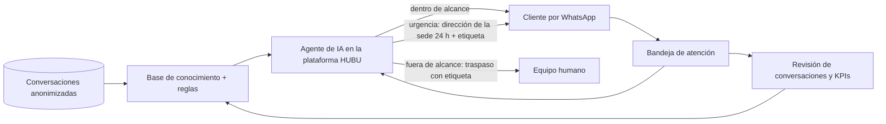

# Caso de estudio — Un agente de IA de atención por WhatsApp, de los datos a producción

Resumen para portafolio profesional, entrevistas y LinkedIn. Cifras agregadas; sin datos de clientes ni de pacientes. Detalle técnico en `docs/05-ia-automatizacion/agente-pet-center-produccion.md`.

## 1. Problema

El volumen conversacional más pesado y repetitivo de la clínica (medicamentos magistrales, venta de productos y domicilios) vivía en WhatsApp, atendido 100 % por personas, con guiones distintos según quién respondía y sin atención humana en las noches, domingos y festivos. En esas franjas el cliente esperaba hasta el día siguiente; en el caso de una urgencia, un mal mensaje puede costar caro.

## 2. Enfoque

Aplicar el principio del proyecto ("primero ordenar, luego automatizar") en cuatro pasos:

1. **Datos:** extraer y anonimizar conversaciones reales (100 de Kommo en 25 categorías y 35 de la línea de la tienda, 12.438 mensajes entre 2020 y 2026) para entender intenciones, reglas de negocio y objeciones.
2. **Alcance acotado:** el agente solo atiende donde no hay personas; no confirma existencias, precios ni dosis; no agenda citas; ante la duda pasa al equipo con etiqueta de motivo.
3. **Reglas explícitas y probables:** reglas de oro, una única regla de urgencias, glosario y flujos por tipo de solicitud, con un conjunto de frases de prueba antes de publicar.
4. **Producción con observación:** lanzamiento el 5/11/2026, lectura de conversaciones reales y KPIs desde el primer día.

## 3. Arquitectura

Alrededor del agente, otra automatización que sí es código propio: el **cruce nocturno entre el call center y Kommo** (`scripts/`), que mueve etapas y carga el valor de las ventas para medir el costo por paciente de cada campaña.

## 4. Mi participación (con precisión)

- **Hice:** diseño y curación de la base de conocimiento y de las reglas del agente; el análisis y anonimización de los datasets; la definición de alcance, de etiquetas de traspaso y de KPIs; las pruebas y la lectura de conversaciones reales; la gestión de riesgos y la coordinación con el proveedor; el cruce nocturno Call center ↔ Kommo (Apps Script y Python); la medición con GA4, Tag Manager y estándar de UTM.
- **No hice:** el motor del agente. HUBU es la plataforma de un proveedor externo; aquí el trabajo es de ingeniería de conocimiento, evaluación y operación, no de desarrollo del modelo ni de la orquestación.

## 5. Resultados (primer corte, 5–9 de noviembre de 2026)

- 37 conversaciones nuevas; el agente respondió 23 (62 %) y pasó 15 a una persona (65 % de las atendidas), con motivo.
- Una urgencia real atendida correctamente con la regla nueva (domingo, mensaje modelo con la dirección de la sede 24 h).
- Línea base de respuesta humana: 9 a 35 minutos en horario del equipo; hasta ≈ 24 h en domingos y festivos. **El cuello de botella no era el agente, era la cobertura humana.**
- Controles que funcionaron: el agente no confirmó existencias ni precios; los traspasos llegaron con etiqueta.

## 6. Lo que salió mal (y qué se aprendió)

- **Dato inventado:** el agente envió a un cliente la dirección, precio y horario de una clínica inexistente. Se añadió una regla explícita, se pidió al proveedor la causa raíz y se definió como KPI "datos inventados por semana = 0".
- **Reglas duplicadas y contradictorias** cambiaban el comportamiento según cuál "ganara". Al retirarlas apareció un efecto no previsto. Aprendizaje: **las reglas se prueban en borrador antes de publicar**; no al revés.
- **Una urgencia indirecta** se respondió con un teléfono en lugar de la dirección. Se cubrió con pruebas de frases indirectas.
- Quedan fallas abiertas (pregunta repetida en un flujo de domicilio, envíos nacionales) con fecha de segunda revisión: 16/11/2026.

## 7. Aprendizajes transferibles

- Un agente de IA se evalúa con conversaciones reales y KPIs de negocio, no con la demo.
- Los guardarraíles (qué NO hace, cuándo escala y cómo se etiqueta) pesan más que la gracia de las respuestas.
- Medir antes de automatizar: sin trazabilidad lead → cita → venta no hay forma de saber si la automatización ayudó.
- La automatización no arregla un proceso humano roto; lo hace visible. Aquí lo visible fue la cobertura de domingos.

## Fuente

Informes de funcionamiento y de ajustes del agente (9/11/2026), dataset de la línea Pet Center (2/10/2026) y registros del cruce nocturno (23–26/10/2026), del Sistema Documental Vivo.
